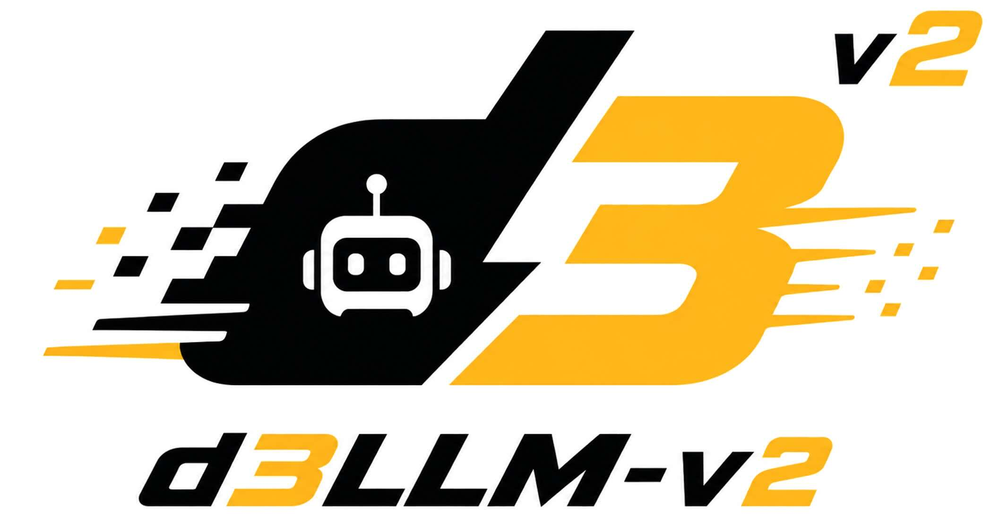
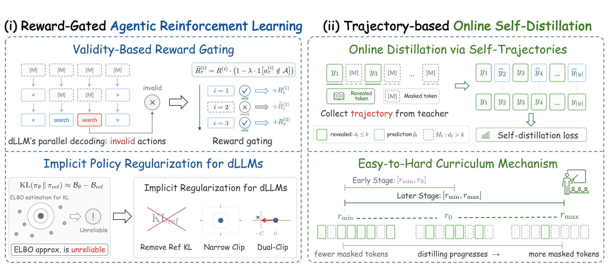

<p align="center">
  
</p>

# d3LLM-v2: Ultra-Fast Agentic Diffusion LLM via Reward Gating and Online Distillation 🚀

<div align="center">

[](https://huggingface.co/d3LLM)
[](https://neurips.cc/virtual/2026/loc/sydney/175977)

</div>

This is the official implementation of the paper **d3LLM-v2: Ultra-Fast Agentic Diffusion LLM via Reward Gating and Online Distillation** (**NeurIPS'26 Workshop**). In this paper we introduce ***d3LLM-v2***, a recipe for training fast and accurate **diffusion LLM (dLLM) agents** with reinforcement learning (RL) 🚀.

## 📣 News
- `[2026/10]`: 🤗 We release the checkpoints on [HuggingFace](https://huggingface.co/d3LLM).
- `[2026/10]`: 🧑‍💻 We release the training, distillation and evaluation code for d3LLM-v2.
- `[2026/09]`: 🎉 Our d3LLM-v2 paper is accepted by the *NeurIPS 2026 Workshop on Diffusion Language Models: Foundations, Efficiency, and Reasoning!* See our [paper](https://neurips.cc/virtual/2026/loc/sydney/175977). 🥳

## 🌟 What is d3LLM-v2?

**d3LLM-v2** extends [d3LLM](https://github.com/hao-ai-lab/d3LLM) from single-turn reasoning to **long-horizon agentic tasks** such as WebShop, Search-R1 and ALFWorld. It first improves the agent's accuracy with reward-gated agentic RL. Then it makes the agent decode faster with online self-distillation.

The code is built on [verl-agent](https://github.com/langfengQ/verl-agent). We replace its autoregressive rollout and actor with an **SGLang-based diffusion rollout** and a **dLLM actor** that supports several log-likelihood estimators. To the best of our knowledge, this is the first open-source framework for on-policy agentic RL of dLLMs.

## 🔬 How d3LLM-v2 Works

<div align="center">


*Overview of the d3LLM-v2 framework.*

</div>

### (i) Reward-Gated Agentic RL 🎯

We gate the rewards by action validity, so the agent is not rewarded for invalid actions. We also replace the explicit KL penalty with an implicit regularization, which keeps the policy updates stable.

### (ii) Trajectory-Based Online Self-Distillation 📚

The model learns to reproduce its own decoding results in fewer steps, along the trajectories that it generates during rollout. An easy-to-hard curriculum on the mask ratio further improves the decoding speed.

## ✨ Features

| Category | Supported |
| - | - |
| **dLLM Backbones** | ✅ SDAR-8B / SDAR-4B (block diffusion)<br>✅ d3LLM-LLaDA / iLLaDA (full attention)<br>✅ Qwen3 (AR baseline) |
| **RL Algorithms** | ✅ d3LLM-v2 (ours)<br>✅ d1, BGPO, GDPO, ESPO |
| **Environments** | ✅ WebShop<br>✅ Search (tool calling)<br>✅ ALFWorld |
| **Metrics** | ✅ Accuracy<br>✅ TPF (tokens per forward)<br>✅ AUP (Accuracy Under Parallelism) |
| **Training** | ✅ Multi-turn rollout with SGLang<br>✅ LoRA and multi-node training with Ray |

## 🎯 Getting Started

### Installation

Run the install script to create the `verl-dllm-agent` conda environment (conda >= 23.10 is required). It installs the local SGLang in `sglang_dllm/`, PyTorch 2.9.1, flash-attn and `transformers==4.57.1`.

```bash
bash scripts/environment_setup/install_verl_agent_new.sh
conda activate verl-dllm-agent
```

> **Note:** Set `RECREATE=1` to rebuild an existing environment. On clusters, put extra settings (CUDA, NCCL, ...) in a script and pass its path with `CLUSTER_ENV_SCRIPT`.

### Environments

Install the agentic environments that you need. Each script works in the main environment and skips the steps that are already done.

```bash
bash scripts/environment_setup/setup_webshop.sh   # WebShop: product catalog, spaCy, Java, search index
bash scripts/environment_setup/setup_alfworld.sh  # ALFWorld: game files in ~/.cache/alfworld
bash scripts/environment_setup/setup_search.sh    # Search: data, e5 index and a separate `retriever` env
```

> **Note:** Do not run the original WebShop `setup.sh`, because it downgrades pinned packages. The Search scripts start the retrieval server on port 8000 automatically.

### Download Models

The model code in `verl/models/` contains our RL log-likelihood path, so only download the **weights** of the base models:

```bash
for m in SDAR-8B-Chat SDAR-8B-Chat-b8 SDAR-4B-Chat SDAR-4B-Chat-b16; do
  hf download JetLM/$m --include "*.safetensors" --local-dir verl/models/$m
done
hf download d3LLM/d3LLM_LLaDA --include "*.safetensors" --local-dir verl/models/d3LLM_LLaDA
```

The released distilled models are in the [d3LLM-v2 collection](https://huggingface.co/collections/d3LLM/d3llm-v2): `SDAR-8B-Chat-distill-{webshop,alfworld,search}`, `SDAR-4B-Chat-distill-{webshop,search}`, `SDAR-8B-Chat-b8-distill-{webshop,search}`, `SDAR-4B-Chat-b16-distill-search` and `d3LLM_LLaDA-distill-webshop`. Search has no SFT stage, so its RL starts directly from the base models.

## 🏋️‍♀️ Training d3LLM-v2 Models

All scripts are in [scripts/training/dllm_trainer/](./scripts/training/dllm_trainer/), with one folder per task and backbone. They use 4 GPUs by default and save outputs to `checkpoints/verl_dllm/<experiment>/`. The examples below use SDAR-8B (block size 4).

### Stage 1: SFT

WebShop and ALFWorld start with SFT, which gives the model the output format of the agent. Search has no SFT stage and goes directly to Stage 2 from the base model.

The SFT code and data are in [dLLM_sft/](./dLLM_sft/). SDAR and the Qwen baselines use LlamaFactory in a separate environment, which the script creates on first run. d3LLM-LLaDA and iLLaDA use the main environment. The SFT models are saved to `dLLM_sft/sfted_models/<name>`, where Stage 2 reads them.

```bash
bash dLLM_sft/SDAR/run_sft.sh webshop-8b-b4       # SDAR-8B-Chat-sfted-webshop
bash dLLM_sft/SDAR/run_sft.sh alfworld-8b-b4      # SDAR-8B-Chat-sfted-alfworld
bash dLLM_sft/d3LLM/run_sft.sh webshop-llada-8b   # d3LLM_LLaDA-sfted-webshop
bash dLLM_sft/AR/run_sft.sh alfworld-qwen3-8b     # Qwen3-8B-sfted-alfworld
```

> **Note:** Before SDAR SFT, link the downloaded weights into the SFT model folders: `ln -sf "$PWD"/verl/models/$m/*.safetensors dLLM_sft/SDAR/training/model/$m/`.

### Stage 2: Agentic RL

On WebShop and ALFWorld, RL starts from the SFT model of Stage 1. On Search, it starts from the base model.

```bash
bash scripts/training/dllm_trainer/webshop_sdar_8b_b4/train_rl.sh   # WebShop
bash scripts/training/dllm_trainer/search_sdar_8b_b4/train_rl.sh    # Search
bash scripts/training/dllm_trainer/alfworld_sdar_8b_b4/train_rl.sh  # ALFWorld
```

### Stage 3: Online Self-Distillation

Distillation starts from the HuggingFace model of your own Stage 2 RL run, given by `MODEL_PATH`. Merge the RL checkpoint first (see [FAQ](#-faq)); the merged model is saved to `<ckpt>/actor_merged_hf`.

```bash
MODEL_PATH=checkpoints/verl_dllm/<webshop_rl_experiment>/global_step_150/actor_merged_hf \
  bash scripts/training/dllm_trainer/webshop_sdar_8b_b4/train_distill.sh        # WebShop
MODEL_PATH=checkpoints/verl_dllm/<alfworld_rl_experiment>/global_step_150/actor_merged_hf \
  bash scripts/training/dllm_trainer/alfworld_sdar_8b_b4/train_distill_lora.sh  # ALFWorld (LoRA)
```

## 🧪 Evaluation

`eval_both.sh` evaluates the latest checkpoint of a training run. Set `origin=True` to evaluate a HuggingFace model given by `MODEL_PATH` instead, such as our released distilled models.

```bash
EVAL_CKPT_DIR=checkpoints/verl_dllm/<experiment> \
  bash scripts/training/dllm_trainer/webshop_sdar_8b_b4/eval_both.sh both
hf download d3LLM/SDAR-8B-Chat-distill-webshop --local-dir checkpoints/released_distill/SDAR-8B-Chat-distill-webshop
origin=True MODEL_PATH=checkpoints/released_distill/SDAR-8B-Chat-distill-webshop \
  bash scripts/training/dllm_trainer/webshop_sdar_8b_b4/eval_both.sh both
```

`standard` decodes with confidence threshold 0.95 and reports accuracy and TPF. `tpf1` uses threshold 1.0, and `both` runs the two in sequence.

## ❓ FAQ

**How to merge an FSDP checkpoint into a HuggingFace model?** Pass the checkpoint and the starting model of the RL stage to [merge_fsdp_ckpt.sh](./scripts/Misc/merge_fsdp_ckpt.sh). The merged model is saved to `<ckpt>/actor_merged_hf`.

```bash
bash scripts/Misc/merge_fsdp_ckpt.sh checkpoints/verl_dllm/<rl_experiment>/global_step_150 \
  dLLM_sft/sfted_models/SDAR-8B-Chat-sfted-webshop
```

**How to compute AUP?** Sweep the decoding threshold from 0.95 to 1.00 to get (TPF, accuracy) pairs. Then pass them in the form `TPF:ACC`.

```bash
python scripts/training/dllm_trainer/calculate_aup.py 1.447:3.4 2.944:57.2 --alpha 3
```

**Where is the core code?** The entry point is [main_dllm_new.py](./verl/trainer/main_dllm_new.py), and the dLLM actor is in [dllm_actor.py](./verl/workers/actor/dllm_actor.py). The diffusion rollout is in [sglang_dllm/](./sglang_dllm/), and the environments are in [agent_system/](./agent_system/).

## 🙏 Acknowledgments

This project builds upon excellent open-source work:
- [verl-agent](https://github.com/langfengQ/verl-agent) and [veRL](https://github.com/volcengine/verl): RL training frameworks for LLM agents
- [SGLang](https://github.com/sgl-project/sglang): fast serving engine, used for the diffusion rollout
- [SDAR](https://github.com/JetAstra/SDAR): block diffusion LLM backbones
- [LLaDA](https://arxiv.org/abs/2502.09992): large language diffusion models, used as full-attention backbones
- [d3LLM](https://github.com/hao-ai-lab/d3LLM): ultra-fast diffusion LLM with pseudo-trajectory distillation
- [WebShop](https://github.com/princeton-nlp/WebShop), [ALFWorld](https://github.com/alfworld/alfworld) and [Search-R1](https://github.com/PeterGriffinJin/Search-R1): agentic environments

## 📝 Citation

If you find d3LLM-v2 useful for your research, please star our project and cite our work.

```bibtex
@inproceedings{d3llmv2,
  title     = {d3LLM-v2: Ultra-Fast Agentic Diffusion LLM via Reward Gating and Online Distillation},
  author    = {Yu-Yang Qian and Yan-Yu Long and Lanxiang Hu and Shen Nie and Chongxuan Li and Peng Zhao and Hao Zhang},
  booktitle = {NeurIPS Workshop on Diffusion Language Models: Foundations, Efficiency, and Reasoning},
  year      = {2026}
}
```

<div align="center">

⭐ Star us on GitHub and cite our paper if you find this project helpful!

</div>
